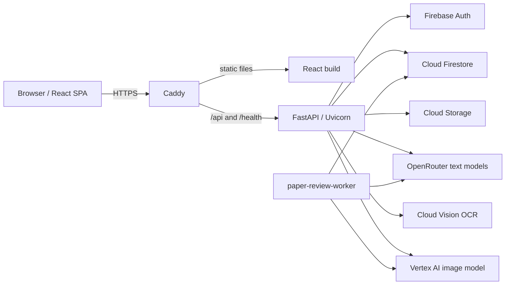

# System architecture

## Production request path

The public VM runs three Compose services: a FastAPI API container, a separate durable paper-review worker using the same backend image, and Caddy for TLS, static files, and reverse proxying. Caddy proxies only `/api/*` and `/health/*`; all other paths fall back to the React single-page application.

## Application boundaries

**Frontend.** The CRA/CRACO React application handles browser routing and Firebase interactive authentication. It makes same-origin API requests in production because the frontend build uses an empty backend base URL.

**API.** FastAPI exposes `/api` routes and two unauthenticated health endpoints. It validates Firebase bearer tokens, maps Firebase users to Bodha profiles, applies role checks, owns synchronous CRUD operations, and persists work before background processing.

**Worker.** `paper_review_worker` claims leased jobs from `paper_review_jobs`. Leases and heartbeats avoid duplicate active work and make interrupted work recoverable. It processes paper generation/review first and permits at most one diagram job to use a spare slot.

**State.** Firestore stores application records. Cloud Storage keeps uploaded/source artifacts and generated binary objects. The VM persistent disk holds deployment state, Caddy state, logs, and token-usage CSV output.

## Provider responsibilities

| Provider | Use |
| --- | --- |
| Firebase Authentication | Browser authentication and Firebase ID token validation. |
| Cloud Firestore | Application documents, queues, completion checkpoints, and metadata. |
| Cloud Storage | Textbooks, branding/media, diagrams, and other object artifacts. |
| OpenRouter | Primary text generation and model-assisted repair/review calls. |
| Vertex AI | Diagram/image generation in the production configuration. |
| Cloud Vision | OCR during document ingestion when enabled. |

## Deployment architecture

Terraform provisions the VPC/subnet/firewall, static IP, VM service account, Artifact Registry, bucket, persistent disk and snapshots, secret resources, monitoring resources, and optional DNS/budget resources. Cloud Build builds immutable backend and frontend images, pushes them to Artifact Registry, reaches the VM through IAP, and invokes the release script.
