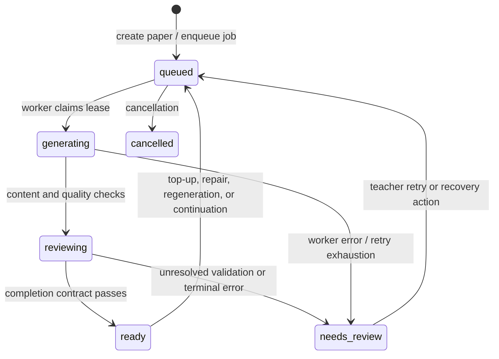

# Paper generation lifecycle

## Durable execution

The API saves the paper and enqueues a durable review job. The worker claims one job with a worker identity and lease token, renews the lease while it works, and writes only while it owns the job. A restart leaves the job eligible for another worker after lease expiry. The worker detects cancellation and revision changes before producing output.

Generation modes include standard teacher papers, saved/official blueprints, competitive papers, targeted missing-question generation, regeneration, internal-choice repair, solutions, and diagrams. The implementation preserves paper revisions so stale jobs cannot overwrite a teacher's newer edit.

## Completion and publication

The completion workflow validates requested counts, section allocation, internal choices, question structure, and export requirements. It may run deterministic normalization/validation plus bounded model-assisted repairs. Safe partial content can remain viewable; export is reserved for papers that satisfy the full contract. The worker records final job status as completed, needs review, cancelled, or superseded.

## Textbook ingestion

1. The API stores an uploaded PDF and creates a textbook record.
2. Ingestion extracts text, chunks it, and persists a representative spread of chunks instead of retaining only a document prefix.
3. Topic extraction runs over persisted chunk context and stores topics/subtopics.
4. A restart reschedules records left in `queued` or `ingesting` state.

## Exports and diagrams

PDF/DOCX renderers run in bounded CPU-oriented pools. Diagram work is separate from paper-review work and is queued only after a ready paper reports pending diagrams. A solution derives from the current question snapshot and must be reconciled against later edits before publication.
