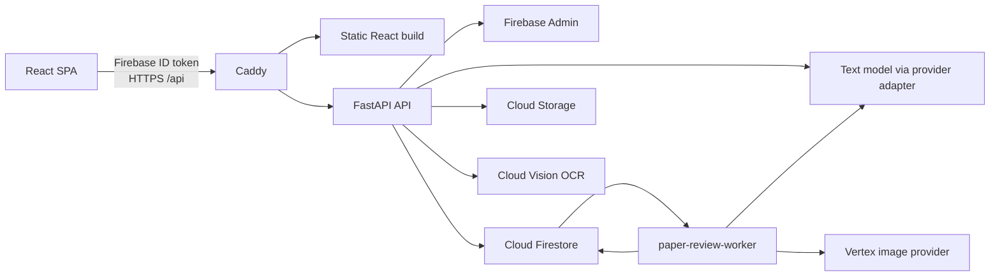
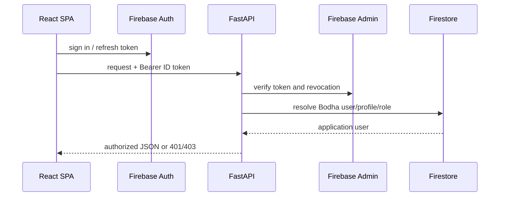
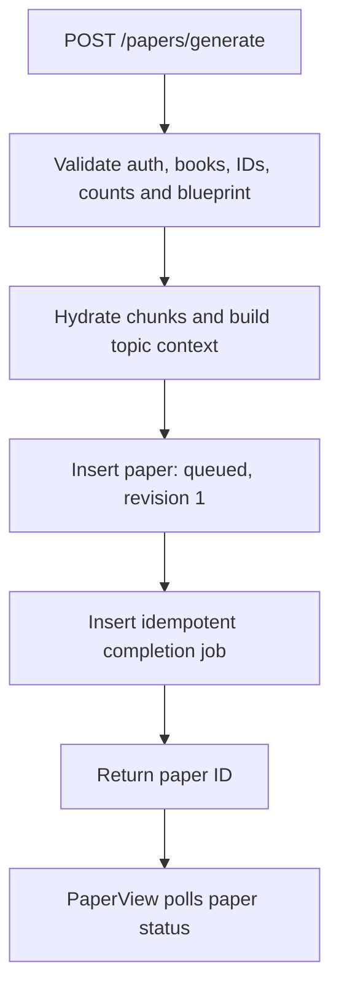
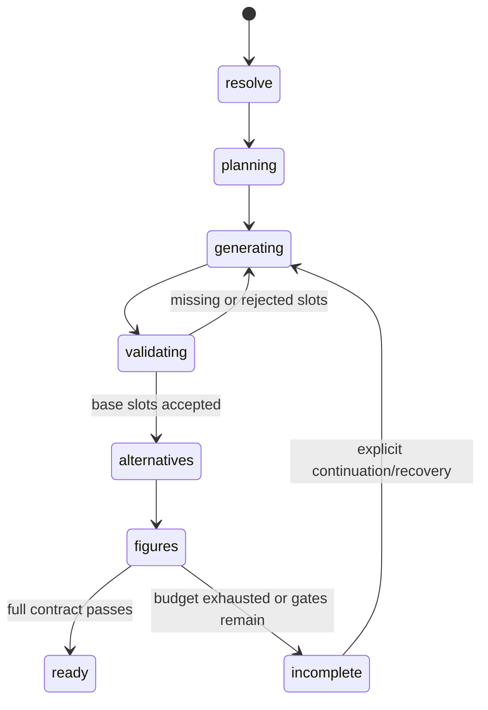

# Technical architecture reference

This is the technical reference for Bodha AI's core teacher-paper path. It is
written in two layers: each feature starts with a short **what and why** brief,
then documents the exact runtime flow, data written, provider boundary, and
failure/recovery behaviour. It covers textbook ingestion, topic indexing,
normal and blueprint-backed paper generation, quality completion, delivery,
and the supporting runtime.

The competitive-exam corpus, student/mock-test experience, and administrative
screens are intentionally not described in depth here. They use the same
identity, persistence, provider, and operational boundaries, but are separate
product flows. See [overview.md](overview.md) for their product-level scope.

## Core-feature map

| Feature | Brief: why it exists | Primary durable records |
| --- | --- | --- |
| Identity and tenancy | Proves the caller and keeps one teacher's sources and papers inaccessible to another. | `users` plus Firebase identity |
| Textbook library | Turns a teacher PDF into bounded, reusable source material without putting the whole PDF into prompts. | `textbooks`, `textbook_chunks`, GCS PDF |
| Topic index | Gives the teacher selectable topics and preserves the source chunks that evidence each topic. | `textbooks.topics` |
| Context retrieval | Gives generation relevant, provenance-labelled excerpts without a vector database or unbounded context cost. | Hydrated `textbook_chunks`; generated `context_excerpt` |
| Paper configuration | Converts teacher intent and optional blueprints into an unambiguous, server-owned contract. | `papers`, job payload |
| Durable completion | Generates and repairs a paper outside the browser request, while surviving restarts and avoiding stale writes. | `paper_review_jobs`, `papers`, checkpoints |
| Review, export, and branding | Makes only structurally complete papers exportable and keeps printable output historically reproducible. | paper projection, GCS artifacts, branding snapshot |

## System shape



The system separates short, user-facing API work from expensive or recoverable
work. The API owns authorization, request validation, state transitions, and
creation of durable records. The worker owns long-running paper completion.
Cloud Firestore is the application database and the durable job queue; Cloud
Storage holds PDFs and generated binary objects.

## Components and ownership

| Component | Main code | Responsibility | Durable data it owns or updates |
| --- | --- | --- | --- |
| Browser SPA | `frontend/src/` | Authentication UX, configuration UI, polling and paper editing | None directly; all mutations use the API |
| Edge | Caddy in `frontend/` image | TLS, static SPA, same-origin proxy of `/api` and `/health` | Caddy certificate/configuration state on VM disk |
| API | `backend/server.py`, route modules | HTTP boundary, authz, synchronous CRUD, ingestion orchestration, job enqueueing | Firestore domain documents |
| Persistence facade | `backend/firestore_compat.py` | Async Mongo-like API over Firestore; Firestore-safe encoding/decoding | Firestore document IDs are internal; application `id` fields are stable |
| Object store | `backend/storage.py` | GCS paths, uploads/downloads, readiness checking | Source PDFs, logos, diagrams, rendered/exported artifacts |
| Ingestion | `server.py`, `pdf_utils.py`, `textbook_content.py` | PDF text extraction, OCR fallback, chunk storage | `textbooks`, `textbook_chunks` |
| Topic index | `textbook_topics.py`, `section_blueprints.py` | Topic/subtopic catalog with source-chunk provenance; bounded prompt context | `textbooks.topics` |
| Completion worker | `paper_review_worker.py`, `paper_review_queue.py` | Job claiming, leases, heartbeats, retries, status transitions | `paper_review_jobs` |
| Completion engine | `paper_completion.py`, `completion_store.py` | Slot planning, batch generation, validation, repair and checkpointing | `papers`, `paper_completion_checkpoints` |
| Model adapter | `llm_adapter.py` | Provider choice, bounded calls, structured-response parsing, token reporting | Usage telemetry/sink |
| Output services | `pdf_utils.py`, `docx_utils.py`, diagram worker functions | Render/export and optional diagram generation | GCS artifacts plus paper metadata |

## Request and identity boundary

**Brief.** Authentication answers “who is this browser user?”; authorization
answers “may this application user read or change this record?” Keeping those
questions separate lets Bodha use Firebase's token security without making
Firebase custom claims the source of product roles, ownership, or profile
state.

The frontend uses Firebase Web SDK authentication. The shared Axios client adds
the current Firebase ID token as `Authorization: Bearer <token>` to each API
request. In production, `REACT_APP_BACKEND_URL` is empty, so `/api` stays
same-origin and Caddy proxies it to FastAPI.

On the API side, `auth.py` verifies the token with Firebase Admin, checks for a
UID and email, then resolves the application's `users` record. Firebase proves
identity; the Firestore user record supplies the application's role and
profile-completion state. Every protected route must scope records by owner
unless it intentionally supports an admin or shared-resource exception.



Do not rely on route guards for authorization: they are UI behavior only. New
server routes should use `get_current_user` or a narrower role dependency and
include `is_deleted: false` where the entity follows the soft-delete model.

### Exact request stages

1. The Firebase Web SDK signs in the browser user and refreshes its Firebase ID
   token as needed.
2. The shared Axios client sends that token in the `Authorization` header to a
   same-origin `/api` URL. Caddy forwards only API/health paths to FastAPI;
   static application routes remain in the React application.
3. `auth.py` uses Firebase Admin to verify the token, including revocation
   checks. A missing, expired, malformed, or revoked token ends here with 401.
4. The API looks up the matching `users` document. This is where the app learns
   the teacher/admin role and whether the required profile is complete.
5. The route applies ownership and sharing rules to the actual query/update.
   For example, a textbook is normally selected by both its stable `id` and
   `owner_id`; shared-library and administrator access are explicit exceptions,
   rather than accidental consequences of knowing an ID.

This ordering is important: the frontend may hide controls for a role, but a
caller can always construct an HTTP request directly. Only the final backend
query/update is a security boundary.

## Textbook ingestion and indexing

**Brief.** Ingestion makes a PDF useful as a source without assuming every PDF
contains a good text layer. It prefers inexpensive local extraction, uses paid
Cloud Vision only for documents that need OCR, then retains a bounded spread
of source text. The resulting index is deliberately a source corpus—not an
LLM summary and not an embeddings/vector index.

### Data model

`textbooks` is compact metadata: owner, Storage path, file hash, subject,
class, visibility, lifecycle state, extraction progress, chunk count, and the
topic catalog. It intentionally does not contain large source text.

`textbook_chunks` stores the persisted extraction payload under `textbook_id`.
Generation paths explicitly hydrate it; library/listing paths do not. This
avoids reading large arrays just to render a textbook card.

### Upload-to-index flow

```mermaid
sequenceDiagram
  participant UI as Textbooks page
  participant API as POST /textbooks/upload
  participant GCS as Cloud Storage
  participant DB as Firestore
  participant Job as API ingestion task
  participant OCR as PDF text / Vision OCR
  UI->>API: PDF + subject + class
  API->>API: validate PDF, size and owner-scoped SHA-256 duplicate
  API->>GCS: persist original PDF
  API->>DB: insert textbook(status=queued)
  API-->>UI: textbook ID and queued state
  API->>Job: start bounded ingestion
  Job->>OCR: extract text; OCR only when needed
  Job->>Job: clean, chunk, representatively sample
  Job->>DB: save textbook_chunks and indexed status
```

The API accepts PDFs up to 500 MB. It writes the PDF to GCS first, then creates
a Firestore textbook record before scheduling work; the record is the durable
truth the UI polls. Ingestion uses a process-wide semaphore and tracks
`processing.status`, timestamps, attempt count, progress, and errors.

`extract_text()` first uses `pypdf` text extraction and strips boilerplate. It
uses Cloud Vision OCR only when usable text is scarce or the PDF appears to be
mostly question-platform metadata rather than prose. OCR is limited to the
first 40 pages, so source quality and size remain important operational inputs.

`chunk_text()` creates approximately 2,500-character chunks with a 200-character
overlap and prefers paragraph boundaries. The system retains no more than 120
chunks for downstream AI use. `spread_chunks()` preserves the first five chunks
(usually containing contents/front matter) and evenly samples the remainder
across the entire book. `chunk_count` remains the unbounded extraction count;
the stored subset is the effective source corpus for topic extraction and
generation.

Ingestion is an in-process background task rather than a `paper_review_jobs`
job. That is intentional but has a recovery requirement: API startup scans
`queued` and `ingesting` textbooks and re-runs them from their GCS object. A
failed extraction becomes `extraction_failed`; it is not silently retried
forever.

### Exact ingestion stages

1. **Validate and deduplicate.** `POST /textbooks/upload` accepts a non-empty
   PDF up to 500 MB. It calculates SHA-256 over the uploaded bytes and rejects
   the same active document within the same owner's library unless duplicate
   upload is explicitly allowed. This prevents needless storage, OCR, and
   later topic-extraction cost while still allowing different teachers to own
   the same source.
2. **Persist before processing.** The original PDF is stored at a stable GCS
   path. Next, the API writes `textbooks` with `status: queued`, zero chunks,
   source metadata, and a durable `processing` projection. Only then is the
   background coroutine scheduled. If the browser disconnects after receiving
   success, the source and state still exist; if the process restarts, the PDF
   can be reacquired from GCS.
3. **Claim bounded local capacity.** `_run_ingestion` enters the
   process-wide `INGESTION_CONCURRENCY` semaphore (default 2), switches the
   record to `ingesting`, increments its attempt number, and clears the prior
   processing error. This protects the API host from several simultaneous
   PDF-rasterization/OCR workloads exhausting CPU or memory.
4. **Extract embedded text first.** `extract_text()` opens the PDF with
   `pypdf`, extracts page text where available, concatenates it, and removes
   known scanner watermarks, URL-only lines, download marks, and bare page
   numbers. This is the normal path for digitally-created PDFs and does not
   invoke a model or a Google OCR request.
5. **Decide whether OCR is justified.** OCR is used only when `allow_ocr` and
   `VISION_OCR_ENABLED` are true *and* cleaned text is under 500 characters,
   or when the text has many question-platform markers but too little prose
   between them. The latter catches PDFs with a nominal text layer containing
   only NTA-style metadata while the question content is actually an image.
   A text-rich digital PDF therefore never incurs Cloud Vision OCR.
6. **Run Cloud Vision OCR when required.** The PDF pages are rasterized locally
   with Poppler/pdf2image at 150 DPI, encoded as PNG (or JPEG if a noisy image
   is too large), then sent one page at a time to Cloud Vision
   `document_text_detection`. Up to five page workers run concurrently. For a
   PDF of 40 pages or fewer every page is attempted; for a longer PDF, no more
   than 40 pages are selected as a spread that includes the opening four and
   closing two pages. Responses are reassembled in page order. OCR usage and
   partial failures are recorded. If OCR returns no text, the extractor falls
   back to the original cleaned PDF text; only a resulting empty chunk set
   causes `extraction_failed`. It never fabricates text after an OCR failure.
7. **Chunk and sample.** Cleaned text becomes roughly 2,500-character chunks
   with a 200-character overlap. The splitter prefers a paragraph break late
   in the window, which avoids cutting a topic in the middle when possible.
   `chunk_count` records every produced chunk, but only 120 are persisted for
   downstream use: the first five plus evenly spaced chunks from the remaining
   document. This intentionally trades full-document storage/prompt cost for
   coverage of both early and late chapters.
8. **Persist the usable corpus.** The selected chunks are written to
   `textbook_chunks`, not embedded in the main textbook document. The textbook
   becomes `indexed` with counts and finish time. A list view can consequently
   read library metadata without transferring large extracted text arrays.

At any stage, the durable `processing` object records status, attempt,
timestamps, counts, and a truncated actionable error. Reindexing repeats the
extraction/chunking stages from the stored original PDF; it clears topics so
the index cannot claim topics supported by a stale chunk corpus.

### Topic extraction and source-aware index

**Brief.** Topic extraction adds a teacher-facing map over already-indexed
source text. This is the first LLM step in the standard textbook path; upload,
OCR, extraction, and chunk persistence themselves make no LLM calls.

Topic extraction is initiated after indexing. It batches persisted chunks in
groups of ten and asks the text model for strict JSON topics and subtopics. The
prompt treats textbook text as data, requires evidence-only topics, and asks
for `source_chunks` indices. Results are merged case-insensitively, subtopics
are deduplicated, and chunk references are retained only when they refer to the
batch that actually supplied them.

The resulting topic record has this conceptual form:

```json
{
  "name": "Electrostatics",
  "subtopics": ["Electric field", "Potential"],
  "source_chunks": [18, 19]
}
```

The topic catalog also creates stable topic identities bound to a textbook.
This matters for multi-book papers: a topic name alone is not sufficient to
identify its source.

### Exact LLM indexing call pattern

The `extract-topics` endpoint first verifies that the caller owns (or may
administer) an indexed textbook and that stored chunks exist. It atomically
claims a topic-extraction record so repeated UI clicks do not create duplicate
work. The background path is protected by `TOPIC_EXTRACTION_CONCURRENCY`
(default 2).

Chunks are grouped ten at a time. For every group, the server builds a prompt
containing only that labelled source text, the textbook subject/class, and a
strict JSON request for evidenced topics, subtopics, and integer
`source_chunks`. The system instruction explicitly says that textbook content
is data rather than instructions. `chat_complete()` submits the request to the
configured text-provider chain, parses the JSON response, and advances the
durable completed-batch count. On completion, topic names are merged
case-insensitively; duplicate subtopics are removed; and source references are
discarded unless they point to a chunk in the very batch that produced them.

The validation of returned source indices is important: an LLM can suggest a
plausible topic, but it cannot create provenance for a chunk it was not given.
If no evidenced topics survive, the operation fails rather than producing a
misleading catalog.

## Standard retrieval model

**Brief.** The application needs sources relevant to the teacher's selected
topics, but it does not need a general semantic-search service for this core
workflow. It therefore uses the topic index plus simple lexical ranking. This
makes retrieval explainable, source-labelled, bounded in cost, and reliable
for a known textbook corpus.

The standard path is not a vector-database RAG pipeline. It has no embedding
creation or nearest-neighbor lookup. Its retrieval unit is the retained text
chunk, selected with both source provenance and lexical topic matching.

Before generation, selected textbook records are hydrated with their chunks.
`topic_context()` then:

1. Resolves unique selected allocations by `(textbook_id, topic_id/name)`.
2. Divides a 30,000-character prompt budget among selected topics.
3. For each topic, prefers the chunks the topic extractor cited.
4. Ranks other chunks by shared normalized words from the topic and parent topic.
5. Selects one unseen candidate chunk per selected topic.
6. Falls back to an evenly spread book sample only when topic lookup produces no excerpts.

The output is labelled with textbook, topic, and chunk identifiers before it is
inserted into prompts. This gives the model bounded source material across all
selected books, including later chapters, rather than a whole-PDF prompt or a
prefix-only excerpt.

The 30,000-character retrieval budget is shared rather than spent by the first
selected topic. For each allocation the algorithm uses one unseen chunk: it
first attempts the source chunks certified by topic extraction, then ranks the
remaining chunks by overlap between normalized words in the topic/parent topic
and normalized words in the chunk. If no allocation produces an excerpt, it
uses a small evenly distributed fallback sample. This is retrieval for prompt
grounding, not a claim that the application has indexed every PDF page or that
the model may rely only on these excerpts.

## Paper configuration and request creation

**Brief.** Configuration translates teacher choices into a stable contract the
server can enforce. The LLM is asked to supply question content, never to be
the authority for question numbering, section layout, marks totals, or the
teacher's chosen constraints.

`NewPaper` collects the source textbooks, topics, subject/class, difficulty,
marks, duration, cognitive distribution, format distribution, diagram count,
custom instructions, branding, and optional blueprint allocations. The UI
performs early usability checks; `/papers/generate` repeats all important
validation because the API is authoritative.

The API verifies textbook visibility and, when present, canonicalizes topic
allocations against the server-side catalog. For direct generation it compiles
the requested topics into weighted rows. For blueprint generation it resolves
the blueprint, validates allocations and stores the canonical requirement
snapshot. The API also constructs two generation-only prompt inputs:

- `context_excerpt`: the bounded topic-aware source excerpts described above.
- `feedback_hints`: aggregate signals from prior teacher edits for the same
  owner, subject, and class.

It then immediately writes a `papers` document with `generation_status: queued`
and a monotonically increasing `generation_revision`, followed by an idempotent
`paper_review_jobs` record. The response returns the paper record so the SPA
can navigate to `PaperView`; it does not wait for model calls.



## Durable generation and job protocol

**Brief.** A paper may need several provider calls and repairs; that is too
slow and failure-prone for one browser request. The durable job protocol makes
progress visible, lets a worker recover after an interruption, and prevents an
older run from overwriting a more recent teacher action.

The Compose deployment runs `paper-review-worker` separately from the API.
`paper_review_jobs` is a Firestore-backed durable queue, not an in-memory task
list. Each job includes a stable ID (`completion:<paper-id>:<revision>` for a
generation), payload, revision, attempt counters, stage, next-run timestamp,
lease token, and diagnostics.

The worker atomically claims one due job through the Firestore facade,
transitioning it to `leased` with a worker identity, opaque lease token and
lease expiry. A heartbeat renews the lease every 20 seconds by default. All
worker-side writes are fence-checked against lease ownership. An expired lease
makes interrupted work eligible for recovery; a revision mismatch makes the job
`superseded` so an old run cannot overwrite a newer teacher action.

There are two levels of recovery:

- Queue retry/backoff for process/provider failures, ending in `needs_review`
  once the job exhausts its configured attempts.
- Completion checkpoints for v2 paper generation, allowing a new lease holder
  to continue the same partially completed plan instead of generating a new paper.

The worker prioritizes paper review/generation jobs. Diagram-only jobs are
separate and limited to one concurrent job, so optional images cannot starve
core text completion.

### Why the queue has leases, revisions, and checkpoints

- A **lease** says which worker may currently write a job. It expires unless a
  heartbeat renews it, making an interrupted worker recoverable instead of
  permanently locking a paper.
- A **lease token** fence-checks worker writes. It prevents a slow, previously
  disconnected worker from writing after another worker has legitimately taken
  over.
- A **generation revision** changes when a teacher action supersedes the
  existing generation. A job for an older revision becomes `superseded`, so it
  cannot overwrite edits or a newer retry.
- A **checkpoint** (v2 completion) stores the plan and accepted/rejected work
  at meaningful boundaries. Recovery can resume missing slots rather than
  asking an LLM to recreate an entire partly-reviewed paper.

## Generation engines: from configuration to paper

**Brief.** Generation is a contract-completion workflow, not one unverified
prompt. The system plans the paper deterministically, obtains bounded batches
of content from the text model, accepts only questions that pass checks, then
repairs the missing or defective pieces without discarding good work.

All standard papers use server-owned requirements, slot plans where applicable,
structured provider output, and worker-side quality gates. The selected engine
is recorded on the durable job through `PAPER_COMPLETION_ENGINE`:

- **v1 (the code default):** `workers.generate_paper_background()` produces a
  candidate, publishes safe partial output when permitted, then performs its
  bounded review and repair flow.
- **v2 (explicit canary/rollout setting):** `paper_completion.py` runs the
  checkpointed slot-completion state machine described below. It adds a durable
  `paper_completion_checkpoints` recovery source and stronger lease-fenced
  continuation semantics.

The worker dispatches according to this persisted job engine version, so a
deployment can consume both versions safely. The model writes question content;
server code owns structural identity, placement, counts, marks, section ordering,
and publication decisions.

### Requirement compilation and slot planning

Both engines first build a normalized requirement specification. In v2, the
following is the completion engine's explicit planning phase.

- `generation_requirements.py` turns UI percentages into stable integer quotas
  using largest-remainder apportionment and combines explicit instruction
  overrides without inventing constraints.
- `instruction_spec.py` parses supported constraints from custom instructions.
- `normal_paper_contract.py` turns non-blueprint requirements into immutable
  slots. It allocates topic coverage, cognitive type, format, marks,
  difficulty, and diagram requirements.
- `section_blueprints.py` supplies the equivalent structural slots for blueprint
  papers: sections, groups, parent/child parts, marks and internal-choice rules.

Every slot has a stable `slot_id`; questions are later reconciled by slot rather
than by model-provided numbering. This is critical for regeneration, partial
recovery, rendering order, and safe merging with teacher edits.

### Batch generation

Slots are grouped into batches of at most 20, with all sibling parts of a
compound/case-study parent kept together. Up to three independent batches may
run concurrently inside the completion workflow.

For each batch, `normal_slots_prompt()` receives subject/class, slot details,
the bounded context excerpt, custom instructions, feedback hints, accepted and
rejected question stems, and parent/case context. The standard path calls the
provider through `_request_paper_json()` with a JSON-only contract. The response
is materialized into the server-owned section/slot plan; model headings and
placement are never trusted as canonical.

### Text-model calls: provider routing, safety, and retries

All text generation—topic extraction, paper batches, targeted repairs, and
selected quality checks—uses `llm_adapter.chat_complete()`. The caller passes
a system instruction and user payload; it does not call OpenRouter or Bedrock
directly. The adapter selects `TEXT_PROVIDER` (`openrouter` in the production
release configuration, or `bedrock`) and a primary/fallback model chain.

For OpenRouter, the adapter posts a Chat Completions payload with system and
user messages, configured token/temperature limits, and usage requested. For
Bedrock, it sends the same logical inputs through Converse. Both provider
clients are synchronous, so `chat_complete()` runs each attempt in a worker
thread rather than blocking FastAPI's event loop. It applies a per-call
timeout, attributes usage, retries transient errors with exponential backoff,
and only then moves to the fallback model. Authentication, invalid-request,
and model-access failures are not retried as transient failures.

Structured provider output is parsed defensively. A response must survive JSON
extraction and downstream schema/contract validation before it becomes
persisted paper content. Provider output is therefore an untrusted content
candidate, while IDs, slots, sections, marks, status changes, and publication
remain server-owned.

### Validate, accept, and repair

Each candidate question is rejected before acceptance when it has malformed
content, LaTeX defects, a topic/marks/difficulty/answerability review failure,
or duplicates an accepted question. Duplicate checks use deterministic
normalization/similarity and can use bounded model assistance where configured.

The v2 engine runs a bounded completion process: at most two repair rounds, a
360-second active budget, and a 24 provider-call cap by default. It persists
state regularly and after meaningful acceptance/rejection decisions. The v1
review budget is separately configured through `PAPER_REVIEW_BUDGET_SECONDS`
and `PAPER_REVIEW_PROVIDER_CALL_LIMIT` (180 seconds and 12 calls in the example
environment).

The final evaluator checks all observable contracts:

- every required slot is present and structurally placed;
- topic, type, format, marks, and section allocation quotas match;
- internal OR alternatives are complete and valid;
- case-study sibling questions share a coherent stimulus;
- required diagrams have been attached;
- no unresolved content or quality gates remain.

Repairs are targeted: missing/rejected slots are regenerated, missing internal
alternatives are regenerated against the original question, and diagrams are
generated only for required/pending figure questions. Existing accepted content
is preserved rather than asking the model to rewrite the whole paper.



## Publication, review state, and exports

**Brief.** A visible draft and an export-ready paper are different guarantees.
Teachers can see useful safe partial progress, but printable artifacts require
the full paper contract so the system does not silently export an incomplete
or structurally invalid exam.

The paper document is a materialized, user-visible projection of generation
state. For v2 jobs, `paper_completion_checkpoints` is the recovery source;
visible `papers.sections` must not be used as the sole resume mechanism. V1
uses the persisted paper projection and its targeted recovery routes.

`generation_status` reports the broad lifecycle (`queued`, `generating`,
`ready`, `needs_review`, `cancelled`, and related recovery states).
`completion` reports the stricter contract result: counts, unresolved slots,
failed gates, preview availability and `export_eligible`. `quality_review`
contains stage, budget, diagnostics and final review status.

A sufficiently complete safe draft can be visible while automatic completion
continues. Export is stricter: PDF/DOCX output is available only when the full
contract passes, unless an explicit supported workflow records an override.
The browser polls the paper resource while it is queued/generating/reviewing
and while completion/diagram status remains active.

PDF and DOCX rendering run in bounded CPU-oriented pools. Diagrams are stored
as objects and their paths are attached to question records. Branding is
snapshotted onto a paper at creation, so later changes to a branding preset do
not silently change historical output.

### Branding and reusable questions

Branding presets are teacher-owned records containing text fields and an
optional image held in Cloud Storage. When a preset is selected, the server
copies a snapshot onto the paper rather than retaining only a preset ID. PDF
and DOCX renderers consume the paper snapshot, so a later preset edit changes
future choices but never rewrites a previously issued paper.

The question bank is a compact teacher-owned reuse surface: a teacher can save
a question from a paper or create one directly, list/filter their own records,
and soft-delete it. It does not bypass the normal paper contract or make a
question globally visible merely because another teacher knows its ID.

## Firestore persistence rules

Firestore is not used as a transparent JSON blob store. The compatibility
layer preserves a small async Mongo-like surface for application modules while
encoding unsupported nested arrays in blueprint structures and restoring them
at read time. Do not bypass it for normal application persistence.

Important collections in this path are:

| Collection | Role |
| --- | --- |
| `users` | App role and profile, resolved after Firebase authentication |
| `textbooks` | Source metadata, status and topic catalog |
| `textbook_chunks` | Retained source context, loaded only when needed |
| `papers` | Current paper projection, revision, metadata, visible sections and status |
| `paper_review_jobs` | Durable leased work and retry diagnostics |
| `paper_completion_checkpoints` | Resumable v2 completion candidate and plan |
| `paper_edits` | Teacher edit history used for feedback signals |
| `branding_presets` | Reusable branding source; paper stores a snapshot |
| `activity_events` | Audit-style user activity |

New code must preserve the application `id` contract, use the documented
ownership/soft-delete filters, and avoid assuming Firestore map iteration is
an ordering guarantee.

## Runtime, external services, and operational failure modes

Production runs three Compose services: FastAPI, `paper-review-worker`, and
Caddy/React. Terraform provisions the surrounding GCP network, IAM, VM,
Artifact Registry, bucket, persistent disk, monitoring and optional DNS/budget
resources. Cloud Build produces immutable frontend/backend images and deploys
them through IAP.

| Dependency | Function | Failure behavior to expect |
| --- | --- | --- |
| Firebase Auth/Admin | Browser sign-in and API token verification | API returns 401; valid Firebase identity without a complete Bodha profile cannot use the workspace |
| Cloud Firestore | State, queue, checkpoints | Readiness fails; jobs cannot be claimed/persisted; never replace durable state with process-local state |
| Cloud Storage | PDFs and generated files | Upload/retrieval failure surfaces to user or creates an ingestion failure; restart recovery needs the original object |
| OpenRouter/text provider | Topics, question content, review/repair | Bounded retries/budgets; job eventually becomes retrying or needs review with diagnostics |
| Cloud Vision | OCR fallback | Only used when PDF extraction is inadequate; a failure leaves indexing failed rather than fabricated text |
| Vertex image provider | Diagrams | Separate, low-priority job path; text-paper completion is protected from diagram concurrency |

`/health/live` indicates the API process is alive. `/health/ready` checks the
critical Firestore and Storage dependencies. When diagnosing a stuck paper,
inspect the paper's revision/status/completion state and its matching queue job
before rerunning anything. The first questions are: is the job leased, has its
lease expired, did the paper revision change, and is there a checkpoint that
can resume safely?

## Non-core flows (brief)

Competitive-exam imports, student mock tests, and administration are not part
of the standard teacher-paper architecture documented above. Competitive import
can use the same PDF extraction/OCR boundary but additionally has an
LLM-assisted question-parsing path and exam-specific retrieval. Student flows
consume published teacher content and persist assignments/results. Admin views
read operational and usage projections and expose selected remediation actions.
All three retain the same Firebase identity verification, Firestore ownership
rules, Cloud Storage artifact boundary, and provider accounting described in
this guide.

## Change guide for developers

- **Add an API capability:** register it on the shared `api_router`, use the
  existing identity dependency, validate Pydantic inputs, scope reads/writes,
  and document its status/error contract.
- **Add expensive work:** persist a durable record and enqueue a visible,
  lease-protected job. Do not make browser success depend on a long in-request
  provider call.
- **Change source context:** retain bounded prompts and textbook/topic identity.
  Any new retrieval method must preserve multi-book isolation and source
  provenance.
- **Change question structure:** update slot compilation, materialization,
  validation, renderer assumptions, recovery logic, and tests together. A
  model response is content input, not the structural source of truth.
- **Change status fields:** keep old paper records and polling clients in mind;
  status is a cross-layer API between worker, backend and `PaperView`.
- **Change queue behavior:** retain atomic claim, lease fencing, heartbeats,
  revision checks, retries, and explicit terminal `needs_review` semantics.

For focused implementation details, see the companion documents on the
[system architecture](architecture.md), [generation lifecycle](generation.md),
[backend](backend.md), [data/security](data-security.md), and
[operations](operations.md).
