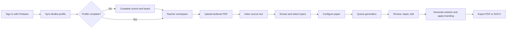
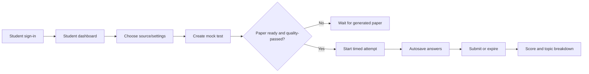

# User journeys

This page describes the real application journeys and the state each journey creates. It is not a UI mockup: route names, guards, API calls, and state labels reflect the implementation.

## Teacher: from first sign-in to a released paper

1. A teacher signs in through `/login` or `/register` using Firebase email/password or Google. The client then calls `POST /api/auth/sync` to bind the Firebase UID to a Bodha user record.
2. The teacher must supply school and board information on `/complete-profile`. Until profile requirements are met, the backend returns `403` for normal workspace API calls.
3. In `/textbooks`, the teacher uploads a source PDF, waits for its durable ingestion status to become `indexed`, then triggers topic extraction and reviews the resulting topics.
4. In `/papers/new`, the teacher selects source books/topics and either configures a normal paper or a predefined/saved blueprint. The UI requests a configuration preview before generation.
5. Generation creates a paper record and durable queue job. The teacher uses `/papers/:id` to see persisted phase/status—not an in-browser background task.
6. A ready paper can be edited, have individual questions regenerated, have missing content or internal choices repaired, receive a solution, receive branding, and then be exported when its completion state permits it.

## Student: timed mock test

The student can create a mock test from the student workflow, but cannot start until its backing paper is ready and has a passing/no quality-review status. Starting establishes `started_at` and `ends_at`. Answer writes are accepted only while `in_progress` and before expiry. Correct options are withheld from the fetched paper until submission/expiry. Auto-grading currently scores MCQs against their saved correct-option metadata and reports total, percent, and topic breakdown.

## Administrator: operational oversight

An administrator enters `/admin`. The API returns fleet-level user/content totals, pending/failed paper indicators, textbook failures, activity, user details, textbook inventory, and paper inventory. An admin can also mark a textbook as shared. Admin visibility is broad, but support actions still run through the same persisted data and role checks as normal workflows.

## Status language

| Area | Important states | What a user should do |
| --- | --- | --- |
| Textbook | `queued`, `ingesting`, `indexed`, `extraction_failed` | Wait for indexing; reindex or inspect error if failed; extract topics after indexed. |
| Topic extraction | queued/running/ready/failed metadata | Wait for ready; retry extraction only after reviewing the failure/source. |
| Paper | `queued`, `generating`, `reviewing`, `ready`, `needs_review`, `cancelled` | Poll the paper; do not refresh-start generation; use the specific recovery action when needs review. |
| Solution | pending/generating/partial/ready/failed metadata | Generate or fill missing answers; remember paper edits may invalidate solution content. |
| Mock test | `not_started`, `in_progress`, `submitted`, `expired` | Start once; autosave during attempt; submit before timer expiry. |
